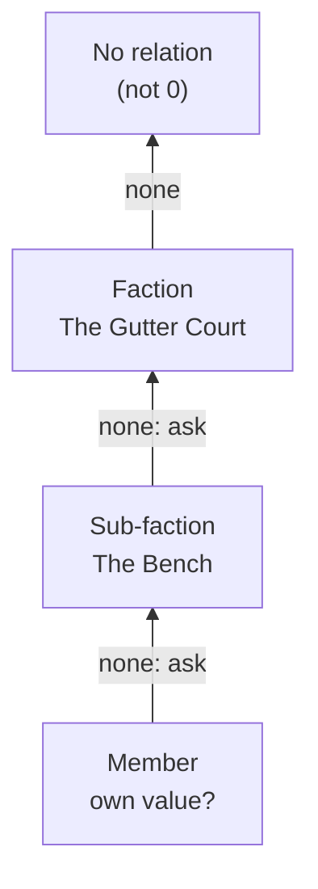

<div align="center">

# 🎲 Obsidian Plugins by Lokianer

**Local-first Obsidian plugins for game masters: plain Markdown in, insight out.**

[](LICENSE)
[](https://github.com/lokianer/obsidian-plugins/actions/workflows/ci.yml)
[](https://www.typescriptlang.org/)
[](https://obsidian.md/)
[](https://pnpm.io/workspaces)

</div>

---

This repository collects the Obsidian plugins I build. Every plugin follows the same principles:

- **Files first.** Your Markdown notes are the truth; anything a plugin derives can be rebuilt from them.
- **Readable without the plugin.** Every convention is plain Markdown and hand-writable YAML.
- **Local and private.** No telemetry, no accounts, no network calls.
- **Mobile too.** Plugins run on desktop and tablet (`isDesktopOnly: false`).
- **Every theme.** Built with Obsidian's CSS variables only, dark theme first.
- **Internationalised.** English UI by default, German as the second language.

## 🧩 Plugins

| Plugin | Id | Status | Description |
| --- | --- | --- | --- |
| [**dnd5e-byLokianer**](plugins/dnd5e-bylokianer/) | `dnd5e-bylokianer` | 🚧 In development (v0.1.0, unreleased) | Game-master tools for D&D 5e: factions and their relations, later NPCs, battles and dice. |

More plugins will follow.

## 🐉 dnd5e-byLokianer

A game master's thinking tool for D&D 5e campaigns kept in Obsidian. It is not a rules engine: the
plugin shows and suggests, the GM decides. It is built in four modules, one after another:

| Module | Status |
| --- | --- |
| ⚔️ **Factions:** factions and how they stand towards each other | 🚧 In progress (phase 1 of 4) |
| 📜 **NPC builder:** stat blocks in 5e style | 🗓️ Planned |
| 🛡️ **Battle tracker** | 🗓️ Planned |
| 🎲 **Dice** | 🗓️ Planned |

### ⚔️ Factions

**Factions are folders.** A folder holding a `factions.md` (or a note named like the folder) is a
faction. The character notes in it are its members, and a faction folder inside another is a
**sub-faction**. Characters outside any faction land in two pseudo-factions, **Party** (`@party`, for
player characters) and **Unaffiliated** (`@unaffiliated`), so they still have a place.

**Relations are numbers you can type.** Each relation is a frontmatter value from **−5** (war) to
**+5** (sworn), one-directional: A → B says nothing about B → A.

```yaml
# Factions/The Gutter Court/factions.md
type: faction
power: 3            # 1–5, node size
relations:          # the public face
  Order of the Lantern: -4
  The Archivists:
    value: 1
    why: "[[Mira Voss]]"
secret_relations:   # the true stance, GM only
  The Archivists: -2
```

- **Public face and true stance.** `relations` is what a faction or character shows the world;
  `secret_relations` is what they really think. Secrets never show in anything marked as public.
- **Inheritance down the chain.** A member's relation is its own value if it states one, else its
  sub-faction's, else its faction's, and so on up the chain. A member's own values are never passed on.
- **Reasons.** Any value can carry a `why`, as a wikilink or plain text.
- **Never fatal.** Hand-edited data goes wrong sometimes. Out-of-range values (clamped to ±5), text
  instead of numbers, unknown keys and relations to oneself each produce a warning. They never cause
  a crash or a blank view.



To find the **true** stance, the plugin walks the same chain but checks `secret_relations` before
`relations` at each level. The first hit wins, so the most specific note always speaks for itself.

#### What exists now vs. what is planned

| | Feature |
| --- | --- |
| ✅ **Now (phase 1)** | Data model: campaign scope (`type: campaign`), faction discovery with sub-factions and members, relation parsing with warnings, public and true stance with inheritance |
| ✅ **Now (phase 1)** | Command **Show faction warnings**: lists every data problem in the campaign |
| 🗓️ Phase 2 | World view: graph with blocs and a matrix, switchable; Public / True toggle; colour scale 🟢 peaceful · 🟡 tense · 🔴 hostile, taken from the theme |
| 🗓️ Phase 3 | Faction view with inherited vs. own values, and a tension panel |
| 🗓️ Phase 4 | Editing with sliders (line edits, never re-serialised YAML) and relation history in session notes |

The full design is in
[`docs/superpowers/specs/2026-10-24-factions-design.md`](docs/superpowers/specs/2026-10-24-factions-design.md).

## 🗺️ Example vault: Silverstadt

[`examples/vault/`](examples/vault/) is the shared test vault for every plugin here. It holds
**Silverstadt**, a campaign city of tides, bells and records, with four factions and a sub-faction,
characters who disagree with their faction, secret stances, 5e stat blocks, an encounter, rollable
tables and a deck. One faction, *The Drowned Choir*, holds every broken value on purpose.
[`Home.md`](examples/vault/Home.md) maps each feature to the notes that test it.

To try it:

```bash
pnpm install
pnpm build
pnpm --filter dnd5e-bylokianer install-example   # copies the build into examples/vault/.obsidian/plugins/
```

Then open `examples/vault` as a vault in Obsidian, enable **dnd5e-byLokianer** under Community
plugins, and run **Show faction warnings** from the command palette.

## 📁 Repository layout

```
obsidian-plugins/
├── plugins/
│   └── dnd5e-bylokianer/   one Obsidian plugin per folder: manifest, src/, test/, its own docs
├── examples/
│   └── vault/              shared test vault (Silverstadt campaign)
├── docs/superpowers/
│   ├── specs/              designs
│   └── plans/              implementation plans per phase
├── .github/workflows/      CI on Linux, macOS and Windows
├── ROADMAP.md              what is done and what comes next
└── HANDOFF.md              where the last session left off
```

Shared pure TypeScript (no Obsidian API) will live in `packages/<name>/` once a module needs it.

## 🛠️ Development

Requires **Node 24** and **pnpm 12**.

```bash
pnpm install       # install the workspace
pnpm lint          # eslint, with eslint-plugin-obsidianmd
pnpm typecheck     # strict TypeScript
pnpm test          # Vitest
pnpm build         # builds every plugin
pnpm --filter dnd5e-bylokianer install-example
```

CI runs lint, typecheck, tests and build on Linux, macOS and Windows for every push and pull request.
No plugin sets default hotkeys; assign your own under Settings → Hotkeys.

Where things stand: [ROADMAP.md](ROADMAP.md) · how the last session ended: [HANDOFF.md](HANDOFF.md).

## 📄 Licence

MIT, see [LICENSE](LICENSE). © 2026 Lokianer.
