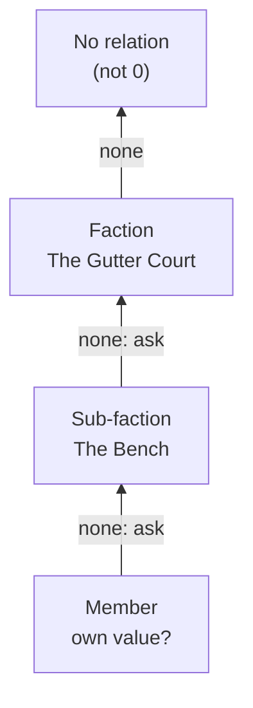

<div align="center">

# 🎲 Obsidian Plugins by Lokianer

**Local-first Obsidian plugins for game masters: plain Markdown in, insight out.**

[](LICENSE)
[](https://github.com/lokianer/obsidian-plugins/actions/workflows/ci.yml)
[](https://www.typescriptlang.org/)
[](https://obsidian.md/)
[](https://pnpm.io/workspaces)

**[Project page](https://lokianer.github.io/obsidian-plugins/)** · [Roadmap](ROADMAP.md) · [Example vault](examples/vault/Home.md)


</div>

---

This repository collects the Obsidian plugins I build. Every plugin follows the same principles:

- **Files first.** Your Markdown notes are the truth; anything a plugin derives can be rebuilt from them.
- **Readable without the plugin.** Every convention is plain Markdown and hand-writable YAML.
- **Local and private.** No telemetry, no accounts, no network calls.
- **Mobile too.** Plugins run on desktop and tablet (`isDesktopOnly: false`).
- **Every theme.** Built with Obsidian's CSS variables only, dark theme first.
- **Internationalised.** English UI by default, German as the second language.

## 🧩 Plugins

| Plugin                                            | Id                 | Status                                 | Description                                                                                          |
| ------------------------------------------------- | ------------------ | -------------------------------------- | ---------------------------------------------------------------------------------------------------- |
| [**dnd5e-byLokianer**](plugins/dnd5e-bylokianer/) | `dnd5e-bylokianer` | 🚧 In development (v0.1.0, unreleased) | Game-master tools for D&D 5e: factions and their relations, NPC stat blocks, later battles and dice. |

More plugins will follow.

## 🐉 dnd5e-byLokianer

A game master's thinking tool for D&D 5e campaigns kept in Obsidian. It is not a rules engine: the
plugin shows and suggests, the GM decides. It is built in four modules, one after another:

| Module                                                          | Status                                                    |
| --------------------------------------------------------------- | --------------------------------------------------------- |
| ⚔️ **Factions:** factions and how they stand towards each other | ✅ Built and accepted in Obsidian (phases 1–5)            |
| 📜 **NPC builder:** stat blocks in 5e style                     | 🚧 Phase 1 of 3 built (stat blocks, short stats on cards) |
| 🛡️ **Battle tracker**                                           | 🗓️ Planned                                                |
| 🎲 **Dice**                                                     | 🗓️ Planned                                                |

### ⚔️ Factions

**Factions are folders.** A folder holding a `factions.md` (or a note named like the folder) is a
faction. The character notes in it are its members, and a faction folder inside another is a
**sub-faction**. Characters outside any faction land in two pseudo-factions, **Party** (`@party`, for
player characters) and **Unaffiliated** (`@unaffiliated`), so they still have a place.

**Relations are numbers you can type.** Each relation is a frontmatter value from **−5** (war) to
**+5** (sworn), one-directional: A → B says nothing about B → A.

```yaml
# Factions/The Gutter Court/factions.md
type: faction
power: 3 # 1–5, node size
relations: # the public face
  Order of the Lantern: -4
  The Archivists:
    value: 1
    why: '[[Mira Voss]]'
secret_relations: # the true stance, GM only
  The Archivists: -2
```

- **Public face and true stance.** `relations` is what a faction or character shows the world;
  `secret_relations` is what they really think. Secrets never show in anything marked as public.
- **Inheritance down the chain.** A member's relation is its own value if it states one, else its
  sub-faction's, else its faction's, and so on up the chain. A member's own values are never passed on.
- **Reasons.** Any value can carry a `why`, as a wikilink or plain text.
- **Never fatal.** Hand-edited data goes wrong sometimes. Out-of-range values (clamped to ±5), text
  instead of numbers, unknown keys and relations to oneself each produce a warning. They never cause
  a crash or a blank view.



To find the **true** stance, the plugin walks the same chain but checks `secret_relations` before
`relations` at each level. The first hit wins, so the most specific note always speaks for itself.

#### What you get

| Feature                 | What it does                                                                                                                                                                                                    |
| ----------------------- | --------------------------------------------------------------------------------------------------------------------------------------------------------------------------------------------------------------- |
| 🃏 **Faction card**     | Replaces Obsidian's Properties on faction and character notes: power, relations with sliders and step names, reasons, secret relations folded away — every control a single-line edit of the note's frontmatter |
| 🕸️ **Faction world**    | Its own tab: a graph where alliances cluster on their own (d3-force) and a matrix of every value; Public / True toggle; drag, pin, pan and zoom                                                                 |
| 🔍 **Faction view**     | Drill into one faction: its members, who is out of line (ringed), own and inherited stances; drag the frame and boxes                                                                                           |
| ⚡ **Tension panel**    | In the sidebar: one-sided pairs, members out of line, public faces hiding a different truth, split allies                                                                                                       |
| ✏️ **Edit in place**    | Click a matrix cell or an arrow for a small popover; the write always lands in the subject's own note                                                                                                           |
| 📓 **Session log**      | After a change, one click logs it under `## Log` of tonight's session (secrets in `[!gm]`); history shows in tooltips; a new session note takes over the loot, marked with where it came from                   |
| 🩺 **Warnings and Fix** | Every data problem listed with its note and key, most with a one-click Fix                                                                                                                                      |
| 📜 **Stat blocks**      | `dnd5e-statblock` blocks (Fantasy Statblocks' keys) render as 5e stat blocks, folded in the note; AC, HP, CR, speed and modifiers sit on the character's card under the name; 21 SRD 5.1 NPCs built in          |

<p align="center">
  
  
</p>

The designs are in [`docs/superpowers/specs/`](docs/superpowers/specs/), starting with
[`2026-10-24-factions-design.md`](docs/superpowers/specs/2026-10-24-factions-design.md) and
[`2026-10-25-npc-builder-design.md`](docs/superpowers/specs/2026-10-25-npc-builder-design.md).

## 🗺️ Example vault: Silverstadt

[`examples/vault/`](examples/vault/) is the shared test vault for every plugin here. It holds
**Silverstadt**, a campaign city of tides, bells and records, with five factions and a sub-faction,
characters who disagree with their faction, secret stances, 5e stat blocks, session notes, an
encounter, rollable tables and a deck. It is kept clean to play with; the notes broken on purpose
for the tests live in `plugins/dnd5e-bylokianer/test/fixtures/vault`.
[`Home.md`](examples/vault/Home.md) maps each feature to the notes that test it.

To try it:

```bash
pnpm install
pnpm build
pnpm --filter dnd5e-bylokianer install-example   # copies the build into examples/vault/.obsidian/plugins/
```

Then open `examples/vault` as a vault in Obsidian, enable **dnd5e-byLokianer** under Community
plugins, open a faction note, and run **Open faction world** from the command palette.

## 📁 Repository layout

```
obsidian-plugins/
├── plugins/
│   └── dnd5e-bylokianer/   one Obsidian plugin per folder: manifest, src/, test/, its own docs
├── packages/
│   └── session/            shared pure TypeScript: tonight's session, log lines, loot carry-over
├── examples/
│   └── vault/              shared test vault (Silverstadt campaign)
├── docs/superpowers/
│   ├── specs/              designs
│   └── plans/              implementation plans per phase
├── site/                   the project page, published to GitHub Pages
├── .github/workflows/      CI on Linux, macOS and Windows; Pages deploy
├── ROADMAP.md              what is done and what comes next
└── HANDOFF.md              where the last session left off
```

## 🛠️ Development

Requires **Node 24** and **pnpm 12**.

```bash
pnpm install       # install the workspace
pnpm check         # everything below, as CI runs it
pnpm format        # Prettier (enforced by a pre-commit hook and CI)
pnpm lint          # eslint, with eslint-plugin-obsidianmd
pnpm typecheck     # strict TypeScript
pnpm test          # Vitest: pure modules in Node, the views in happy-dom
pnpm build         # builds every plugin
pnpm --filter dnd5e-bylokianer install-example
```

CI runs format check, lint, typecheck, tests and build on Linux, macOS and Windows for every push
and pull request. In a fresh clone run `git config core.hooksPath .githooks` once.
No plugin sets default hotkeys; assign your own under Settings → Hotkeys.

Where things stand: [ROADMAP.md](ROADMAP.md) · how the last session ended: [HANDOFF.md](HANDOFF.md).

## 📄 Licence

MIT, see [LICENSE](LICENSE). © 2026 Lokianer.

The NPC stat blocks include material from the System Reference Document 5.1 by Wizards of the Coast
LLC, licensed under [CC-BY-4.0](https://creativecommons.org/licenses/by/4.0/legalcode) — see
[`plugins/dnd5e-bylokianer/src/npc/NOTICE.md`](plugins/dnd5e-bylokianer/src/npc/NOTICE.md).
