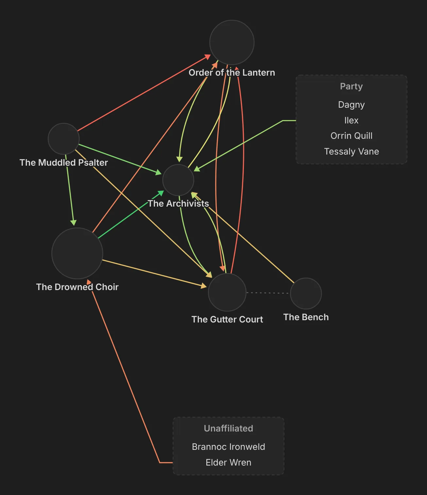
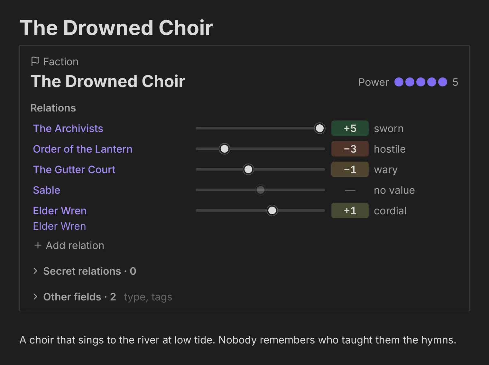
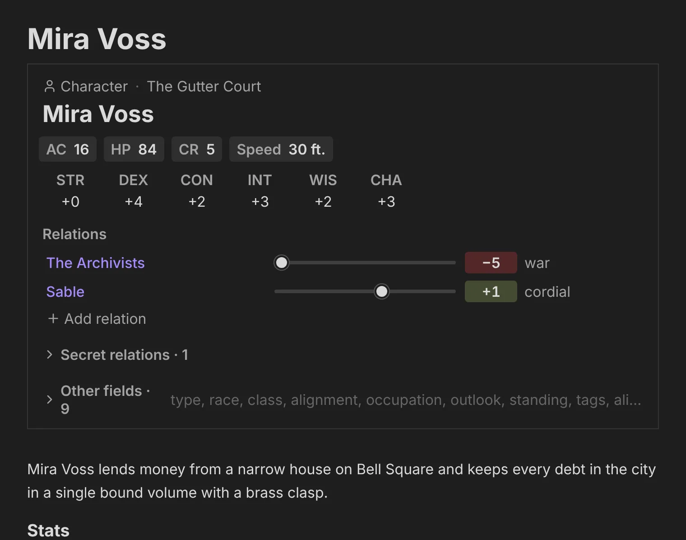
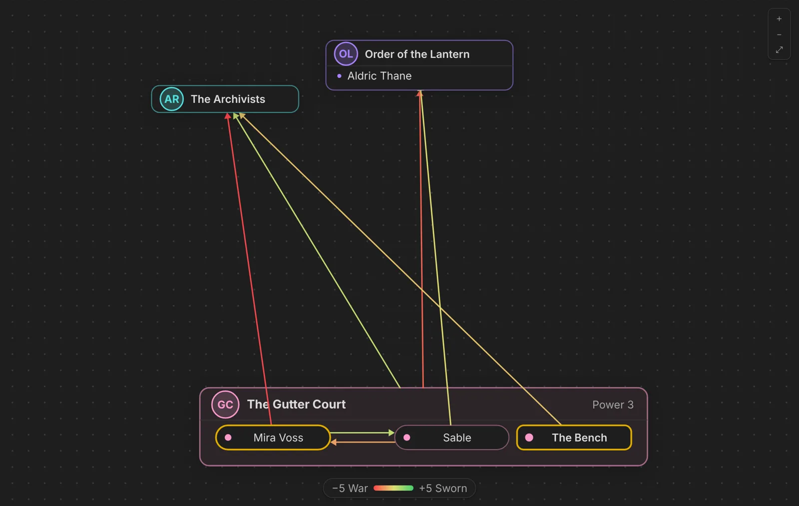
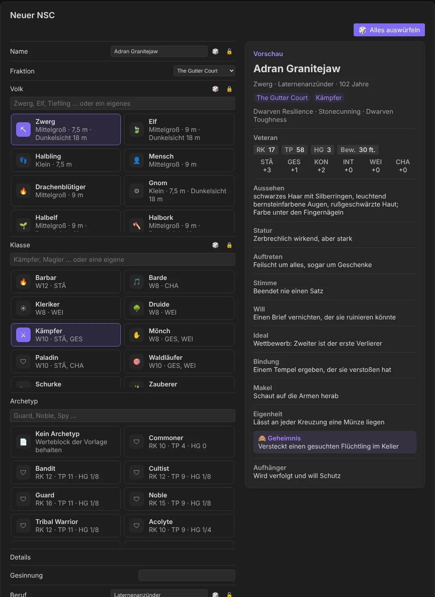

<div align="center">

# 🎲 Obsidian Plugins by Lokianer

**A collection of local-first Obsidian plugins: plain Markdown in, insight out.**

[](LICENSE)
[](https://github.com/lokianer/obsidian-plugins/actions/workflows/ci.yml)
[](https://www.typescriptlang.org/)
[](https://obsidian.md/)
[](https://pnpm.io/workspaces)

**[Project page](https://lokianer.github.io/obsidian-plugins/)** · [Roadmap](ROADMAP.md) · [Example vault](examples/vault/Home.md)



</div>

---

This is a collection repository: every Obsidian plugin I build lives here, one per folder, sharing
the same principles, tooling, CI and example vault. Every plugin follows the same principles:

- **Files first.** Your Markdown notes are the truth; anything a plugin derives can be rebuilt from them.
- **Readable without the plugin.** Every convention is plain Markdown and hand-writable YAML.
- **Local and private.** No telemetry, no accounts, no network calls.
- **Mobile too.** Plugins run on desktop and tablet (`isDesktopOnly: false`).
- **Every theme.** Built with Obsidian's CSS variables only, dark theme first.
- **Internationalised.** English UI by default, German as the second language.

## 🧩 Plugins

| Plugin                                            | Id                 | Status                                 | Description                                                                                                                                      |
| ------------------------------------------------- | ------------------ | -------------------------------------- | ------------------------------------------------------------------------------------------------------------------------------------------------ |
| [**dnd5e-byLokianer**](plugins/dnd5e-bylokianer/) | `dnd5e-bylokianer` | 🚧 In development (v0.1.0, unreleased) | Game-master tools for D&D 5e: factions and their relations, NPCs with stat blocks, a spellbook, the Deck of Many Things, later battles and dice. |

More plugins will join the collection. Each plugin has its own `README.md`, `CHANGELOG.md` and
`DECISIONS.md` in its folder; a plugin that is ready for Obsidian's directory gets its own release
repository, pushed by CI from its subfolder (Obsidian reads `manifest.json` from a repository's root).

### 🐉 dnd5e-byLokianer

A game master's thinking tool for D&D 5e campaigns kept in Obsidian. It is not a rules engine: the
plugin shows and suggests, the GM decides. It grows in modules, one after another:

| Module                                                                                                              | Status                                                          |
| ------------------------------------------------------------------------------------------------------------------- | --------------------------------------------------------------- |
| ⚔️ **Factions:** factions as folders, relations as numbers, a colour-coded faction world, tensions, session log     | ✅ Built and accepted in Obsidian                               |
| 📜 **NPC builder:** 5e stat blocks, New NPC with races, classes, archetypes, dice tables (EN/DE), preview and locks | 🚧 Phases 1–4b built, awaiting the check in Obsidian            |
| ✨ **Spellbook:** the SRD's 319 spells in their own tab, with filters, English and German                           | 🚧 Built (tab and German texts), awaiting the check in Obsidian |
| 🃏 **Deck of Many Things:** the standard deck or your own                                                           | 🚧 Standard deck built, awaiting the check; own decks next      |
| 🛡️ **Battle tracker**                                                                                               | 🗓️ Planned                                                      |
| 🎲 **Dice**                                                                                                         | 🗓️ Planned                                                      |

<p align="center">
  
  
</p>

<p align="center">
  
  
</p>

Everything about it — conventions, views, commands, settings — is in its
[README](plugins/dnd5e-bylokianer/README.md). The designs are in
[`docs/superpowers/specs/`](docs/superpowers/specs/).

## 🗺️ Example vault: Silverstadt

[`examples/vault/`](examples/vault/) is the shared test vault for every plugin here; a new plugin
adds its notes there and a row to its `Home.md`. Today it holds
**Silverstadt**, a campaign city of tides, bells and records, with five factions and a sub-faction,
characters who disagree with their faction, secret stances, 5e stat blocks, session notes, an
encounter, rollable tables and a deck. It is kept clean to play with; the notes broken on purpose
for the tests live in `plugins/dnd5e-bylokianer/test/fixtures/vault`.
[`Home.md`](examples/vault/Home.md) maps each feature to the notes that test it.

To try it:

```bash
pnpm install
pnpm build
pnpm --filter dnd5e-bylokianer install-example   # copies the build into examples/vault/.obsidian/plugins/
```

Then open `examples/vault` as a vault in Obsidian, enable **dnd5e-byLokianer** under Community
plugins, open a faction note, and run **Open faction world** from the command palette.

## ➕ Adding a plugin

1. A folder `plugins/<plugin-id>/` with `manifest.json`, `package.json`, `src/`, tests and its
   docs (`README.md`, `CHANGELOG.md`, `DECISIONS.md`, `LICENSE`) — `plugins/dnd5e-bylokianer/` is
   the template.
2. Logic two plugins share goes into `packages/<name>/` (pure TypeScript, no Obsidian API).
3. Its test notes go into `examples/vault/`, with rows in `Home.md`.
4. A row in the plugin table above, a card on the project page (`site/index.html`) and a section in
   `ROADMAP.md`.

## 📁 Repository layout

```
obsidian-plugins/
├── plugins/
│   └── dnd5e-bylokianer/   one Obsidian plugin per folder: manifest, src/, test/, its own docs
├── packages/
│   └── session/            shared pure TypeScript: tonight's session, log lines, loot carry-over
├── examples/
│   └── vault/              shared test vault (Silverstadt campaign)
├── docs/superpowers/
│   ├── specs/              designs
│   └── plans/              implementation plans per phase
├── site/                   the project page, published to GitHub Pages
├── .github/workflows/      CI on Linux, macOS and Windows; Pages deploy
├── ROADMAP.md              what is done and what comes next
└── HANDOFF.md              where the last session left off
```

## 🛠️ Development

Requires **Node 24** and **pnpm 12**.

```bash
pnpm install       # install the workspace
pnpm check         # everything below, as CI runs it
pnpm format        # Prettier (enforced by a pre-commit hook and CI)
pnpm lint          # eslint, with eslint-plugin-obsidianmd
pnpm typecheck     # strict TypeScript
pnpm test          # Vitest: pure modules in Node, the views in happy-dom
pnpm build         # builds every plugin
pnpm --filter dnd5e-bylokianer install-example
```

CI runs format check, lint, typecheck, tests and build on Linux, macOS and Windows for every push
and pull request. In a fresh clone run `git config core.hooksPath .githooks` once.
No plugin sets default hotkeys; assign your own under Settings → Hotkeys.

Where things stand: [ROADMAP.md](ROADMAP.md) · how the last session ended: [HANDOFF.md](HANDOFF.md).

## 📄 Licence

MIT, see [LICENSE](LICENSE). © 2026 Lokianer.

dnd5e-byLokianer's NPC stat blocks, races and spells include material from the System Reference Document 5.1 by Wizards of the Coast
LLC, licensed under [CC-BY-4.0](https://creativecommons.org/licenses/by/4.0/legalcode) — see
[`plugins/dnd5e-bylokianer/src/npc/NOTICE.md`](plugins/dnd5e-bylokianer/src/npc/NOTICE.md).
